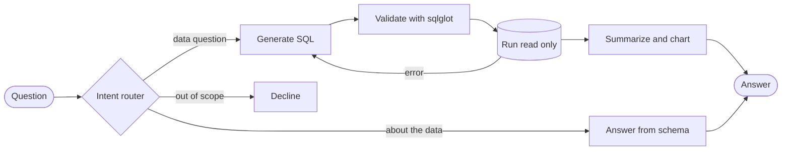

  

---

## About me

- **Gen AI engineer** building LLM agents, text to SQL systems and FastAPI backends, based in **Mumbai, India**
- Built and deployed **Ask Your Data**, a LangGraph agent that answers business questions from any dataset, with **97.9% accuracy** on a 48 question benchmark
- Background in **data science and analytics** through two internships at AI Variant (customer segmentation, ETL pipelines, BI dashboards)
- **3+ years of corporate operations** experience, so I build for real users and real business workflows
- Pursuing a **BCA in Artificial Intelligence and Data Science** at Amrita Vishwa Vidyapeetham
- How I work: ship the smallest end to end version first, then measure it, test it and harden it

---

## Featured project

<table>
<tr>
<td width="100%">

### [Ask Your Data](https://github.com/hoshangsheth/ask-your-data) &nbsp;·&nbsp; [Live demo](https://ask-your-data-chi.vercel.app)

**Ask business questions in plain English and get answers with tables and charts.** A LangGraph agent writes, validates and runs SQL on the demo store or on your own uploaded CSV, Excel, JSON or Parquet files.

<table>
<tr>
<td align="center" width="33%"><b>97.9%</b> accuracy on 48 questions (100% on follow ups)</td>
<td align="center" width="33%"><b>4.4 s</b> median answer time</td>
<td align="center" width="33%"><b>$0.002</b> cost per answer</td>
</tr>
<tr>
<td align="center"><b>18 of 18</b> unsafe queries blocked</td>
<td align="center"><b>199 tests</b> about 87% coverage, CI on every push</td>
<td align="center"><b>64,968 requests</b> load test, 0.0015% errors</td>
</tr>
</table>

- **Intent routing:** each question is sent to SQL, answered from the schema, or politely declined
- **Conversation memory:** follow ups like *"and by city?"* are rewritten into standalone questions
- **Self correction loop:** SQL and database errors are fed back to the model for another attempt
- **Guardrails:** sqlglot AST validation, read only transactions and per user schema isolation
- **Evaluation harness:** execution accuracy by category, plus latency, tokens and cost per question
- **Product features:** accounts with private uploads, CSV, Excel and PDF exports, answer feedback logged to Excel or Google Sheets, and an animated light and dark theme

</td>
</tr>
</table>

---

## Tech stack

<table>
<tr>
<td valign="top" width="50%">

**Generative AI**
 

 
RAG · prompt engineering · structured outputs · embeddings · vector databases · LLM evaluation

</td>
<td valign="top" width="50%">

**Machine learning and data**
 

 
Pandas · NumPy · XGBoost · clustering · feature engineering · ETL · Power BI · Tableau

</td>
</tr>
<tr>
<td valign="top">

**Backend and APIs**
 

 
Pydantic · SQLAlchemy · REST APIs · pytest

</td>
<td valign="top">

**Cloud, CI/CD and tools**
 

 
Neon Postgres · Vercel Blob · GitHub Actions CI · Ruff

</td>
</tr>
</table>

---

## Experience

- **Data Scientist Intern** · AI Variant · *Jan 2025 to Apr 2025*
  - Built a K-Means customer segmentation model whose segments contributed to a **20% lift** in targeted campaign conversion
  - Shared model outputs with stakeholders through a Streamlit app
- **Data Analyst Intern** · AI Variant · *Feb 2024 to May 2024*
  - Automated Python ETL pipelines feeding dashboards, cutting data processing time by **50%**
  - Built Power BI and Tableau KPI dashboards and supported A/B tests (**15%** engagement rise)
- **Earlier experience (2019 to 2023)** · Accurate Background, CommVersion, WNS Global Services
  - Operations, data verification and lead qualification roles: accurate records at volume and data driven workflow improvements

---

## Right now

- Hardening **Ask Your Data** with real user feedback
- Going deeper on **RAG, agent evaluation and LLM cost and latency optimisation**
- Open to **Gen AI, LLM engineering and Python developer** roles

---

## GitHub activity

  

<picture>
  <source media="(prefers-color-scheme: dark)" srcset="https://raw.githubusercontent.com/hoshangsheth/hoshangsheth/output/github-snake-dark.svg" />
  <source media="(prefers-color-scheme: light)" srcset="https://raw.githubusercontent.com/hoshangsheth/hoshangsheth/output/github-snake.svg" />
  
</picture>

---

**Let's build something useful.** &nbsp;Reach me on [LinkedIn](https://www.linkedin.com/in/shethhoshang/) or by [email](mailto:hoshangsheth@gmail.com).

